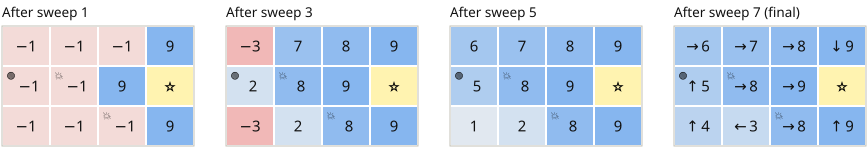
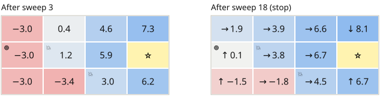
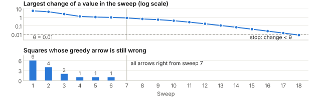
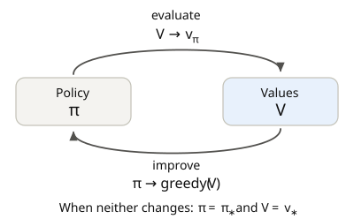
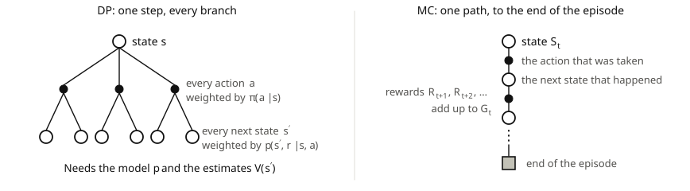
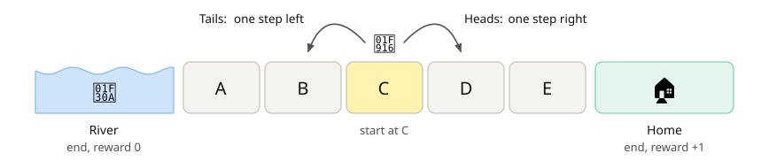
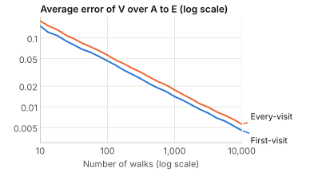

# Reinforcement Learning <br> (DSAI 402)
## Lecture 5: Value Iteration and Monte Carlo Prediction

**Prof. Mohamed Ghalwash**
<Email v="mghalwash@zewailcity.edu.eg" />
_Zewail City University_

:: note ::

Lecture 5, Monday 26 October 2026

---
layout: top-title
color: sky-light
align: lt
title: Today
---

:: title ::

# Agenda

:: content ::

**Objectives**: you should be able to run value iteration on a small MDP, explain generalized policy iteration, estimate $v_\pi$ by averaging the returns of played episodes and tell first-visit MC from every-visit MC.

- Finish DP: value iteration, when to stop and generalized policy iteration
- Why we need a method that works without the model
- Monte Carlo prediction: returns, first-visit and every-visit MC
- Apply it: the fourth application paper, AlphaGo
- Practice it: the bridge walk game

<!--
Timing: about 30 minutes for Part 1, 30 for Part 2, 15 for the paper, 25 for the game and 15 for the wrap-up.
If time is tight, skip the slide on how fast the error shrinks and shorten the paper.
-->

---
layout: section
color: sky
---

# Part 1: Finishing Dynamic Programming

---
layout: top-title
color: light
align: lt
title: Recap
---

:: title ::

# Where We Stopped: Policy Iteration

:: content ::

Policy iteration repeats two steps until the policy stops changing.

$$
\pi_0 \xrightarrow{\;E\;} v_{\pi_0} \xrightarrow{\;I\;} \pi_1 \xrightarrow{\;E\;} v_{\pi_1} \xrightarrow{\;I\;} \pi_2 \xrightarrow{\;E\;} \cdots \xrightarrow{\;I\;} \pi_*
$$

- **Evaluate (E)**: sweep the Bellman equation for $v_\pi$ again and again until the values settle.
- **Improve (I)**: in every state, switch to the greedy action, i.e. the action with the largest $q_\pi(s, a)$.

On last week's slippery grid, the three evaluations took about 27, 12 and 10 sweeps.

<!--
These counts use in-place sweeps with theta = 0.01, and each evaluation starts from the values of the one before.
-->

---
layout: top-title
color: light
align: lt
title: Why wait
---

:: title ::

# Do We Have to Wait for the Values to Settle?

:: content ::

- The improvement step only asks **which action is best**, and rough values are often enough.

- So we do not wait. In every sweep, each state takes the value of its **best** action, not the value of the action its policy picks.

- This puts one evaluation sweep and one improvement step together. It is called **value iteration**.

---
layout: top-title
color: light
align: lt
title: The update
---

:: title ::

# Value Iteration

:: content ::

Policy evaluation from last week, for comparison:

$$
v_{k+1}(s) \leftarrow \sum_a \pi(a \mid s) \sum_{s', r} p(s', r \mid s, a) \left[ r + \gamma\, v_k(s') \right]
$$

Value iteration: take the Bellman optimality equation and use it as an update rule.

$$
v_{k+1}(s) \leftarrow \max_a \sum_{s', r} p(s', r \mid s, a) \left[ r + \gamma\, v_k(s') \right]
$$


- The only change is that $\sum_a \pi(a \mid s)$, which averages over the policy's actions, becomes $\max_a$, which takes the best action.

- No policy is kept during the sweeps.

<AdmonitionType type='tip'>
Value iteration is policy iteration with every evaluation cut to a single sweep.
</AdmonitionType>

---
layout: top-title
color: light
align: lt
title: Back to the grid
---

:: title ::

# Value Iteration on the Grid With No Dice

:: content ::

We use last week's grid with no dice, $\gamma = 1$ and every value starting at 0. In each sweep, every square takes the best of its 4 moves, i.e. the points of the move + the value where it lands.

{width=100%}

- The good news spreads out from the ⭐ by one square per sweep.
- In sweep 5, 🟢 drops the path through 💥 (worth 2) for the path over the top (worth 5). No improvement step was needed.
- Sweep 8 changes nothing, so we stop. These are the values and arrows that policy iteration gave last week.

<!--
Each sweep uses only the values of the sweep before, i.e. two arrays.
Ask the class to do sweeps 1 and 2 on paper before showing the figure.
Two squares have ties at the end. The square left of the top right corner can go right or down, and the bottom 💥 can go up or right. Both moves give 8. The figure shows right, as in last week's table.
-->

---
layout: top-title
color: light
align: lt
title: The algorithm
---

:: title ::

# The Value Iteration Algorithm

:: content ::

```text
Input: small threshold θ > 0
Set V(s) = 0 for every state s, including the terminal states

repeat
    Δ = 0
    for each non-terminal state s:
        old = V(s)
        V(s) = max_a Σ_{s',r} p(s',r|s,a) [ r + γ V(s') ]
        Δ = max(Δ, |old − V(s)|)
until Δ < θ

π(s) = argmax_a Σ_{s',r} p(s',r|s,a) [ r + γ V(s') ]   for every state s
return π, V
```

- From any start, $V$ gets closer to $v_*$. With $\gamma < 1$, each sweep shrinks the largest error by at least a factor $\gamma$, as in policy evaluation.
- The stop test is on the values. The greedy policy is often right much earlier.

<!--
This version works in place, as in last week's algorithm. The figures on the next slides use two arrays so they are easy to check by hand.
The claim "from any start" holds for gamma < 1. With gamma = 1, as in our grid, it still holds here, because the star can be reached from every square and every move costs a point, so a policy that never reaches the star has a value of minus infinity.
-->

---
layout: top-title
color: emerald-light
align: lt
title: With dice
---

:: title ::

# Value Iteration on the Slippery Grid

:: content ::

Now the floor is slippery ($\tfrac{4}{6}$ the arrow and $\tfrac{1}{6}$ to each side), with $\gamma = 1$ and every value starting at 0.

{width=78% .mx-auto}

After sweep 18, no value changed by more than $\theta = 0.01$, so we stop. The values and arrows are the same as those of policy iteration last week.

---
layout: top-title
color: light
align: lt
title: Stopping
---

:: title ::

# When Should We Stop?

:: content ::

{width=100%}

- All arrows are right from sweep 7, but the values keep changing until sweep 18.
- From sweep 4 to sweep 6 the arrows did not change, yet one of them was still wrong. So we cannot stop just because the arrows stopped changing. We stop on the values.


---
layout: top-title-two-cols
columns: is-6
align: l-lt-lt
color: light
title: The big picture
---

:: title ::

# Generalized Policy Iteration (GPI)

:: left ::

{width=100%}

:: right ::

There is one policy π and one value table V. Evaluation updates V to match π and improvement makes π greedy with respect to V.

| Method | Evaluation before each improvement |
|---|---|
| Policy iteration | Until the values settle |
| Value iteration | One sweep |
| MC control (this lecture) | One episode |

<AdmonitionType type='important'>
Most methods in this course follow GPI. They differ in how they evaluate.
</AdmonitionType>

<!--
When neither step changes anything, the values belong to the policy and the policy is greedy with respect to the values. Then the Bellman optimality equation holds, so the policy is optimal.
-->

---
layout: top-title
color: light
align: lt
title: Where DP breaks
---

:: title ::

# What If Nobody Tells Us the Dice?

:: content ::

DP needs the model $p(s', r \mid s, a)$, e.g. the die of the slippery grid.

On a **new floor**, nobody knows the die. 

<v-click> 

We can still

1. let the robot follow its policy until it reaches the ⭐,
2. add up the rewards, which gives one return, and
3. repeat many times and take the average.


<AdmonitionType type='important'>
Play and average. This is Monte Carlo.
</AdmonitionType>

</v-click> 
<!--
Ask the class how they would find the value of 🟢 on the new floor without a formula. Most will say "try it many times". That is the whole idea of Monte Carlo.
-->

---
layout: section
color: sky
---

# Part 2: Monte Carlo Prediction

---
layout: top-title
color: light
align: lt
title: The idea
---

:: title ::

# Learning From Episodes

:: content ::

The value is an expected return, so we can estimate it by averaging the returns we saw.

$$
v_\pi(s) = \mathbb{E}_\pi\left[ G_t \mid S_t = s \right] \;\approx\; \frac{1}{N(s)} \sum_{i=1}^{N(s)} G_i(s)
$$

- Play many episodes with $\pi$.
- Each time an episode visits $s$, write down the return that follows. $G_i(s)$ is the $i$-th such return and $N(s)$ counts them.
- The average gets closer to $v_\pi(s)$ as $N(s)$ grows.

MC needs **episodes that end**, because a return is known only at the end. It also needs a way to **play** $\pi$, in the real world or in a simulator.

<!--
The name comes from the Monte Carlo casino. Any method that answers a question by averaging random samples is called a Monte Carlo method.
-->

---
layout: top-title
color: light
align: lt
title: DP or MC
---

:: title ::

# One Backup in DP and in MC

:: content ::

{width=100%}

- DP moves $V(s)$ toward $\sum_a \pi(a \mid s) \sum_{s', r} p(s', r \mid s, a) \left[ r + \gamma V(s') \right]$, which is an average over every branch.
- MC moves $V(s)$ toward the return $G_t$ that happened. It uses only real rewards, so the estimate of one state does not depend on the estimates of other states.

<!--
An open circle is a state, a filled dot is an action and the gray square is the end of the episode.
Using other estimates, as DP does with V(s'), is called bootstrapping. MC does not bootstrap. TD, next lecture, does.
Because MC estimates each state on its own, the cost of estimating one state does not depend on how many states there are.
-->

---
layout: top-title-two-cols
columns: is-6
align: l-lt-lt
color: light
title: Computing returns
---

:: title ::

# Compute the Returns Backward

:: left ::

An episode gives $S_0, A_0, R_1, S_1, A_1, R_2, \dots, S_{T-1}, A_{T-1}, R_T$.

Use $G_t = R_{t+1} + \gamma G_{t+1}$ and start from the end.

```text
G = 0
for t = T-1, T-2, ..., 0:
    G = γ G + R_{t+1}
    # G is now the return from time t
```

One pass from the end gives every return in the episode.

:: right ::

Example with $\gamma = 1$:

$$
A \xrightarrow{+2} B \xrightarrow{0} A \xrightarrow{+1} \text{end}
$$

| $t$ | State | $R_{t+1}$ | $G_t$ |
|---|---|---|---|
| 2 | $A$ | $+1$ | $1$ |
| 1 | $B$ | $0$ | $0 + 1 = 1$ |
| 0 | $A$ | $+2$ | $2 + 1 = 3$ |

---
layout: top-title
color: light
align: lt
title: Two ways to count
---

:: title ::

# First-Visit and Every-Visit MC

:: content ::

A state can show up more than once in an episode. **First-visit MC** averages only the return after the first visit in each episode (in bold). **Every-visit MC** averages the returns after every visit.

| | Path, with $\gamma = 1$ | Returns of $A$ | Returns of $B$ |
|---|---|---|---|
| Episode 1 | $A \xrightarrow{+2} B \xrightarrow{0} A \xrightarrow{+1} \text{end}$ | **3**, 1 | **1** |
| Episode 2 | $B \xrightarrow{+3} A \xrightarrow{-1} B \xrightarrow{+2} \text{end}$ | **1** | **4**, 2 |
| First-visit $V$ | | $(3 + 1)/2 = 2$ | $(1 + 4)/2 = 2.5$ |
| Every-visit $V$ | | $(3 + 1 + 1)/3 \approx 1.67$ | $(1 + 4 + 2)/3 \approx 2.33$ |

<!--
Both estimates get closer to v_pi as the number of episodes grows.
Let the class compute the returns of episode 2 on paper first. Backward: B at t=2 gets 2, A at t=1 gets -1 + 2 = 1 and B at t=0 gets 3 + 1 = 4.
First-visit MC is unbiased. Every-visit MC is biased for a finite number of episodes, but the bias goes to zero. Sutton and Barto focus on first-visit MC in Chapter 5.
-->

---
layout: top-title-two-cols
columns: is-6
align: l-lt-lt
color: light
title: Averages without a list
---

:: title ::

# The Incremental Mean

:: left ::

We do not need to keep every return. The average of the first $n$ returns comes from the average of the first $n - 1$.

$$
V_n = V_{n-1} + \frac{1}{n}\big( G_n - V_{n-1} \big)
$$

Almost every update in RL has this shape.

$$
\text{new} = \text{old} + \text{step size} \times (\text{target} - \text{old})
$$

:: right ::

The every-visit returns of $A$ were 3, 1 and 1.

| $n$ | $G_n$ | Update | $V_n$ |
|---|---|---|---|
| 1 | 3 | $0 + \frac{1}{1}(3 - 0)$ | 3 |
| 2 | 1 | $3 + \frac{1}{2}(1 - 3)$ | 2 |
| 3 | 1 | $2 + \frac{1}{3}(1 - 2)$ | 1.67 |

<!--
Where it comes from: V_n = (G_1 + ... + G_n) / n = (G_n + (n - 1) V_{n-1}) / n = V_{n-1} + (G_n - V_{n-1}) / n.
With a fixed step size alpha instead of 1/n, recent returns count more. This helps when things change over time, e.g. when the policy keeps changing. TD uses the same shape with a different target.
-->

---
layout: top-title
color: light
align: lt
title: The algorithm
---

:: title ::

# First-Visit MC Prediction

:: content ::

```text
Input: policy π
Set V(s) = 0 and N(s) = 0 for every state s

repeat for many episodes:
    play one episode with π:  S_0, A_0, R_1, ..., S_{T-1}, A_{T-1}, R_T
    G = 0
    for t = T-1, T-2, ..., 0:
        G = γ G + R_{t+1}
        if S_t does not appear in S_0, ..., S_{t-1}:      # first visit
            N(S_t) = N(S_t) + 1
            V(S_t) = V(S_t) + (G − V(S_t)) / N(S_t)

return V   (close to v_π)
```

- For every-visit MC, drop the first-visit check and always update.
- No model anywhere. Only the states and rewards that we saw.

---
layout: top-title
color: light
align: lt
title: Strengths and weaknesses
---

:: title ::

# What MC Prediction Gives and Costs

:: content ::

| Good | Bad |
|---|---|
| No model needed | Works only for episodes that end |
| Easy to code and easy to check | Learns only at the end of each episode |
| Can focus on the states we care about | Rare states get very few returns |
| No bias. Each first-visit return is an unbiased sample of $v_\pi(s)$ | High variance. One return depends on every random step in the episode |

You will see the variance with your own hands in the game at the end of the lecture.

---
layout: top-title
color: light
title: Apply it
---

:: title ::

# Questions for the AlphaGo Paper

:: content ::

1. The value network is trained on $z$, which is the final result of a game. Which MC idea from today is this? Does it need $p(s', r \mid s, a)$?
2. Why take only one position from each self-play game? What would go wrong with all positions from the same game?
3. A rollout uses a weak fast policy. Whose value does it estimate, the strong player's or the fast policy's?
4. One rollout gives $+1$ or $-1$. About how many rollouts do you need to tell a position worth $0.1$ from one worth $0.2$?
5. Last week's sepsis paper also had a reward only at the end. Why could AlphaGo use MC targets while the sepsis paper could not play new episodes at all?
6. Which parts of AlphaGo would your project mentor need to trust before using a similar system in their field?

---
layout: section
color: sky
---

# Practice: The Bridge Walk

---
layout: top-title
color: light
align: lt
title: Practice
---

:: title ::

# The Bridge Walk

:: content ::

{width=100%}

- Work in pairs. Each walk starts at C.
- Flip a coin and move the robot one square. Keep flipping until it reaches 🏠 or falls into 🌊.
- Every move gives 0 points, except the move into 🏠, which gives $+1$. Use $\gamma = 1$.
- Play **4 walks**.

---
layout: top-title
color: light
align: lt
title: Practice
---

:: title ::

# Write Down Each Walk

:: content ::

For each walk, write the flips, the squares the robot stood on and how the walk ended.

| Walk | Flips | Path | End | Reward at the end |
|---|---|---|---|---|
| 1 | T H H H H | C B C D E | 🏠 | $+1$ |
| 2 | T T T | C B A | 🌊 | $0$ |
| 3 | | | | |
| 4 | | | | |


---
layout: top-title
color: light
align: lt
title: Practice
---

:: title ::

# Run MC on Your Walks

:: content ::

1. For each walk, compute the return at every step by going backward. With $\gamma = 1$, what do you notice?
2. **First-visit**: for each square, count the walks that visited it and how many of those walks reached 🏠.
3. **Every-visit**: for each square, count all visits and how many of those visits were in walks that reached 🏠.
4. Divide to get $V$ for each square, both ways.

With walks 1 and 2 only:

| | A | B | C | D | E |
|---|---|---|---|---|---|
| First-visit: 🏠 / walks | 0 / 1 | 1 / 2 | 1 / 2 | 1 / 1 | 1 / 1 |
| Every-visit: 🏠 / visits | 0 / 1 | 1 / 2 | 2 / 3 | 1 / 1 | 1 / 1 |

---
layout: top-title
color: light
align: lt
title: Pool the results
---

:: title ::

# What Is Each Square Worth?

:: content ::

Each pair reads its counts and we add them up on the board.

| | A | B | C | D | E |
|---|---|---|---|---|---|
| First-visit: 🏠 / walks | | | | | |
| Every-visit: 🏠 / visits | | | | | |

- Which square has the most visits? Why?
- Which squares have the fewest first visits? Are their estimates more or less noisy?

<!--
C has the most visits because every walk starts there and walks often come back to it.
A and E get the fewest first visits because many walks end before they reach them. Fewer returns give noisier estimates.
-->

---
layout: top-title
color: light
align: lt
title: Compare
---

:: title ::

# What the Computer Gets

:: content ::

The computer played two classes of 60 walks each and then 10,000 walks. First-visit estimates:

| | A | B | C | D | E |
|---|---|---|---|---|---|
| Class 1 (60 walks) | 0.23 | 0.37 | 0.55 | 0.69 | 0.89 |
| Class 2 (60 walks) | 0.12 | 0.36 | 0.53 | 0.70 | 0.89 |
| 10,000 walks | 0.17 | 0.34 | 0.50 | 0.67 | 0.84 |
| **True value** | **0.17** | **0.33** | **0.50** | **0.67** | **0.83** |

- With 60 walks the classes disagree and miss the true values. With 10,000 walks they are close.
- The true values are $\tfrac{1}{6}, \tfrac{2}{6}, \dots, \tfrac{5}{6}$, i.e. the chance that a walk from that square ends at 🏠.

<!--
Where the true values come from: with gamma = 1 and the only reward at home, the value of a square is the chance of reaching home before the river. With a fair coin, v(s) = 0.5 v(left) + 0.5 v(right), where stepping into the river is worth 0 and stepping into home is worth 1 (the reward). So the values grow in equal steps from 1/6 to 5/6. This is the Bellman equation solved with the model, i.e. that the coin is fair. MC never used that fact.
This is the random walk of Sutton and Barto, Example 6.2. We will use it again to compare MC with TD.
The numbers come from a simulation with fixed random seeds.
-->

---
layout: top-title-two-cols
columns: is-7
align: l-lt-lt
color: light
title: Variance
---

:: title ::

# How Fast Does the Error Shrink?

:: left ::

{width=100%}

:: right ::

- The error shrinks like $1/\sqrt{N}$, i.e. 100 times more walks give about 10 times less error.
- Every-visit MC counts more returns, but the extra returns come from the same walks. Here its error is a bit higher.

<!--
The error is the root mean square error over the five squares. It is averaged over 400 repeats of the whole experiment.
From 10 to 1,000 walks, the first-visit error drops from 0.15 to 0.014.
-->

---
layout: top-title
color: light
align: lt
title: Reflect
---

:: title ::

# Debrief

:: content ::

- Did your averages use the chance of heads anywhere? <span v-click="1" style="background: #fff3b0; padding: 0.1em 0.5em; border-radius: 0.3em;">no, only the paths and how they ended. That is model-free</span>

- What was one walk? <span v-click="2" style="background: #fff3b0; padding: 0.1em 0.5em; border-radius: 0.3em;">an episode, because it starts at C and always ends</span>

- With γ = 1, what was the return at each step of a walk? <span v-click="3" style="background: #fff3b0; padding: 0.1em 0.5em; border-radius: 0.3em;">the final reward, i.e. 1 for 🏠 and 0 for 🌊</span>

- Why did C get more every-visit counts than walks? <span v-click="4" style="background: #fff3b0; padding: 0.1em 0.5em; border-radius: 0.3em;">the robot often comes back to C in the same walk</span>

- Why did the class numbers differ from the true values? <span v-click="5" style="background: #fff3b0; padding: 0.1em 0.5em; border-radius: 0.3em;">few walks. The error shrinks like 1 over the square root of the number of walks</span>

- If the coin were not fair and nobody told you, what would change in your work? <span v-click="6" style="background: #fff3b0; padding: 0.1em 0.5em; border-radius: 0.3em;">nothing. You would play and average in the same way</span>

---
layout: top-title
color: light
align: lt
title: Lab preview
---

:: title ::

# The Bridge Walk in Gymnasium

:: content ::

```python
import gymnasium as gym

class BridgeWalk(gym.Env):
    # 0 = river, 1 to 5 = A to E, 6 = home
    def __init__(self):
        self.observation_space = gym.spaces.Discrete(7)
        self.action_space = gym.spaces.Discrete(1)    # no choice, the coin decides

    def reset(self, seed=None, options=None):
        super().reset(seed=seed)
        self.s = 3                                    # start at C
        return self.s, {}

    def step(self, action):
        self.s += 1 if self.np_random.random() < 0.5 else -1
        reward = 1.0 if self.s == 6 else 0.0
        terminated = self.s in (0, 6)
        return self.s, reward, terminated, False, {}
```

In the lab, you will run first-visit and every-visit MC on it and compare with the true values.

<!--
This environment passes the Gymnasium environment checker, and first-visit MC with 20,000 walks gives values within 0.01 of the true values.
It is also a small template for the project. Teams need a Gymnasium environment of their own for week 7.
-->

---
layout: top-title
color: light
align: lt
title: Avoid these
---

:: title ::

# Common Mistakes

:: content ::

- Stopping value iteration as soon as the arrows stop changing. Stop on the values.
- Discounting the wrong term. The update is $G = \gamma G + R_{t+1}$, not $G = G + \gamma R_{t+1}$.
- Using $R_t$ instead of $R_{t+1}$, i.e. the reward that led into the state.
- Updating $V$ in the middle of an episode. MC knows $G_t$ only at the end.
- Forgetting the first-visit check, which turns first-visit MC into every-visit MC.
- Trusting an estimate made from very few returns.
- Using MC on a task whose episodes may never end.

---
layout: top-title
color: light
align: lt
title: Your turn
---

:: title ::

# Practice Check

:: content ::

1. Write the value iteration update. What is the only change from policy evaluation?
2. On the slippery grid, the arrows did not change from sweep 4 to sweep 6, but one of them was still wrong. What does this tell you about when to stop?
3. For the episode $B \xrightarrow{+1} A \xrightarrow{+1} B \xrightarrow{-2} \text{end}$ with $\gamma = 0.5$, compute every return. Then give the first-visit and every-visit estimates of $V(B)$.
4. In the bridge walk, change the river reward to $-1$. What is the true value of C, and why?
5. Why does MC need episodes that end, while DP does not?
6. Your estimate of $V(A)$ comes from 4 returns. About how many returns do you need to cut its error in half?

<!--
Answers.
2. Arrows that stay the same for a few sweeps can still change later. We stop when the values change by less than theta.
3. Backward: B at t=2 gets -2, A at t=1 gets 1 + 0.5(-2) = 0 and B at t=0 gets 1 + 0.5(0) = 1. First-visit V(B) = 1. Every-visit V(B) = (1 - 2)/2 = -0.5.
4. 0. From C, half of the walks end at home (+1) and half in the river (-1).
5. MC needs the return, which is known only at the end. DP uses the model and the values of the next states, so it never waits for an end.
6. About 16, since the error shrinks like 1 over the square root of the number of returns.
-->

---
layout: grid-cards
cols: 4
---

:: card-1 ::
#### Value iteration
Policy evaluation with a max, i.e. the Bellman optimality equation as an update

:: card-2 ::
#### Stopping
Stop on the values, not when the arrows stop changing

:: card-3 ::
#### GPI
Evaluation and improvement working on the same values and policy

:: card-4 ::
#### Model-free
Learn values from played episodes, without $p(s', r \mid s, a)$

:: card-5 ::
#### Monte Carlo
Estimate a value by averaging the returns of real episodes

:: card-6 ::
#### Return, backward
$G = \gamma G + R_{t+1}$ from the last step to the first

:: card-7 ::
#### First and every visit
Average the return after the first visit to a state or after every visit

:: card-8 ::
#### Variance
One return is noisy. The error shrinks like $1/\sqrt{N}$

---
layout: top-title
color: sky-light
align: lt
title: Before next week
---

:: title ::

# Before We Meet Again

:: content ::

1. **Read Sutton and Barto, Sections 4.4, 4.6 and 5.1**.
2. **Write a short response to the AlphaGo paper**, with a focus on the questions on the slide.
3. **Read the TD-Gammon paper for week 6**: Tesauro, Communications of the ACM 38(3), 1995.

Next lecture: Monte Carlo control, i.e. finding a good policy from played episodes, and then learning from each step without waiting for the end of the episode.

<AdmonitionType type='tip'>
Ask yourself now if your project environment has episodes that end. If an episode can go on for a very long time, MC will learn slowly.
</AdmonitionType>

---
layout: section
title: Questions
class: text-center
---

# Learn More

[Course Homepage](https://github.com/m-fakhry/DSAI-402-RL)
